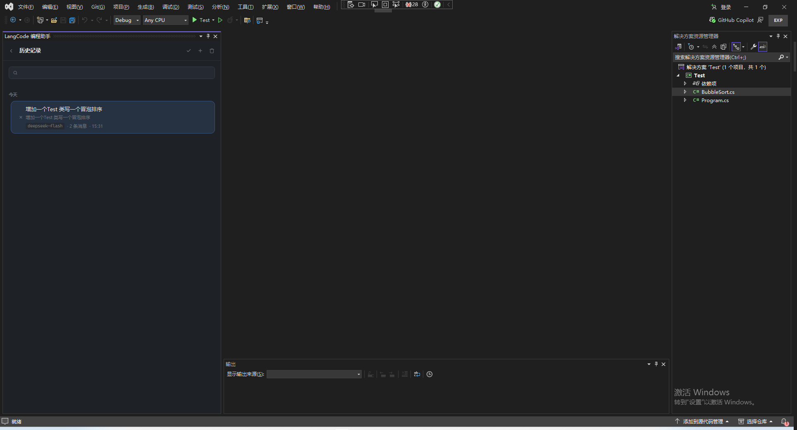

# LangCode

**Visual Studio 里的 AI 编程助手。** 它会聊天，但不止会聊天 —— 它能直接读懂你的项目、动手改代码、跑命令和测试，而且每一次「动你的文件」之前都会先给你看清楚改了什么，你点头它才落地。

> 一句话：把「能真正干活」的 AI Agent 装进 Visual Studio 的工具窗口。


-5C2D91.svg)


---

## 目录

- [它是什么](#它是什么)
- [界面截图](#界面截图)
- [它能做什么](#它能做什么)
- [快速开始](#快速开始)
- [怎么用](#怎么用)
- [支持的 AI 模型](#支持的-ai-模型)
- [安全与隐私](#安全与隐私)
- [数据存在哪里](#数据存在哪里)
- [从源码构建](#从源码构建)
- [项目结构](#项目结构)
- [常见问题](#常见问题)
- [许可证](#许可证)

---

## 它是什么

平时用 AI 写代码，常见的问题是：它看不到你的项目、只能把代码贴给你、你得自己复制粘贴。LangCode 解决的就是这个问题。

它作为一个**工具窗口**嵌在 Visual Studio 里，可以：

- 自己打开你的文件、搜索你的代码、看懂你的项目结构；
- 直接把改动写进你的文件（**改之前一定先给你看差异**）；
- 帮你运行命令、跑测试、甚至操作浏览器自测；
- 你随时可以叫停、拒绝，或一键还原到之前的版本。

---

## 界面截图

### 主界面


### 对话


### 设置页


### 历史页



---

## 它能做什么

下面按「你实际会用它干的事」来讲，而不是按技术名词。

### 💬 1. 像一个懂你项目的助手一样对话

直接用中文（或英文）描述你想做的事，例如「帮我把登录页的表单校验加上」「这个报错是什么原因」。它能自动带上你**当前打开的文件**、**选中的代码**和**编译错误信息**，不需要你每次手动复制。

### 🔍 2. 帮你读代码、找代码

项目大了不好找东西？可以直接问：

- 「用户登录的逻辑在哪个文件？」
- 「`CalculateTotal` 这个方法被哪些地方调用了？」
- 「`IUserService` 有哪些实现类？」

它会用自己的搜索能力（关键词搜索、语义检索、符号查找）快速定位，再把相关的代码片段读给你看。

### ✏️ 3. 直接帮你改代码（改之前先给你确认）

这是它最核心的本事。它不止给建议，而是**真的动手改文件**：

- 小改动：局部替换；
- 大改动 / 跨文件重构：一次改多处；
- 按「符号」改：比如「把 `Login` 这个方法的内部重写一遍」，不用你抄原代码；
- 批量重命名：把某个类 / 方法 / 变量的名字一次改到所有引用处（自动跳过字符串和注释）。

**重要**：每一次写文件，它都会在窗口里显示一张**差异卡**，把「加了几行、删了几行」标得清清楚楚，你点「应用」它才真正保存。不满意就点拒绝。

### 🖥️ 4. 帮你跑命令、跑测试

需要装依赖、构建项目、跑测试？它可以在你的工作区里执行命令，比如 `npm install`、`dotnet build`、`npm test`。

它还会**自动识别你的项目类型**（.NET / Node.js / Python / Rust / Go …），所以「跑一下测试」这种模糊的指令它也知道该敲哪条命令，跑完把结果读回来分析。

> 出于安全，危险命令（删盘、格式化、清空系统目录等）会被直接拒绝；命令执行前默认也要你确认。

### 🌐 5. 前端自测 / 浏览器自动化

做 Web 开发时，它可以打开你本地的开发地址，做导航、点击、填表单、执行脚本、截图、读取浏览器控制台的报错。适合「改完前端想快速看一眼有没有白屏 / 报错」的场景。

### 🐞 6. 调试器联动

调试状态下，它可以帮你：

- 看看断点、调用栈、当前各个变量的值；
- 求值某个表达式（比如 `user.Name` 是什么）；
- 设置 / 删除断点，继续、单步、暂停、停止。

等于把一个「会看调试器状态的助手」放在身边。

### 🔌 7. 接入 MCP 工具（让它能力可扩展）

MCP 是一套「给 AI 用的工具协议」。你可以在设置里连接各种 MCP 服务器（文件系统、数据库、GitHub 等等），连接后 AI 就能调用这些能力。它还支持**从别的 AI 工具一键导入**已有的 MCP 配置，不用重配。

### 📋 8. 复杂任务自动帮你排计划

任务一多，它会用一张**任务清单**列出「要做哪几步」，完成一步更新一步，你可以随时看到进度，也可以在它跑偏时打断。

### ⏪ 9. 后悔药：检查点 / 一键还原

它会在改动前偷偷记一个快照。如果改得不满意，可以**还原到之前某个时间点**，不用担心把代码改乱。

### 🧩 10. 自由换模型

想用哪家的 AI 就用哪家的：国内的 DeepSeek、kimi、通义千问、智谱，国外的 OpenAI、Anthropic、Gemini、Grok，或者跑在自己电脑上的 Ollama / LM Studio（免费、不联网）。还可以把多套配置**命名保存**（比如「公司网关」「本地模型」），随时切换。

---

## 快速开始

### 环境要求

| 项目 | 要求                              |
| ---- | --------------------------------- |
| 系统 | Windows 10 / 11                   |
| IDE  | Visual Studio 2022（17.0 及以上） |
| 框架 | .NET Framework 4.7.2              |

### 安装

1. 下载 / 构建得到 `LangCode.vsix`；
2. 双击按提示安装；
3. 重启 Visual Studio。

### 配置并使用

1. 打开工具窗口：菜单 **工具 → 打开 LangCode**（也可以在代码窗口右键 → **LangCode**）；
2. 在**设置**里选一个「API 提供商」，填入你的 API Key（用本地模型可留空）；
3. 选一个模型（下拉里可选，也可以直接输入模型名）；
4. 在输入框里描述你的需求，回车开始。

---

## 怎么用

### 直接对话

在输入框里正常打字即可。它会自动感知你当前打开的文件和选中的代码。

### 用 `@` 提及文件

输入 `@` 可以快速指定某个文件，让 AI 重点看它。

### 用 `/` 呼唤常用指令

在输入框里输入 `/` 会弹出命令列表：

| 命令       | 作用                                     |
| ---------- | ---------------------------------------- |
| `/plan`    | 先别动代码，只做调研并给出分步计划       |
| `/review`  | 审查你还没提交的改动，按严重程度列出问题 |
| `/commit`  | 按规范生成提交信息                       |
| `/test`    | 为最近改动的代码补单元测试               |
| `/fix`     | 先说清根因，再给最小改动                 |
| `/explain` | 解释一段代码的作用和坑                   |
| `/clear`   | 清空当前会话（历史仍在）                 |

### 代码窗口右键菜单

选中一段代码，右键 → **LangCode**，可以：

- **解释选择**：讲清楚这段代码在干嘛；
- **重构选择**：帮你重构；
- **生成测试**：补单元测试；
- **生成文档**：补注释 / 文档；
- **修复选择**：定位并修问题；
- **内联编辑（Ctrl+K）**：在光标处直接改，改完就地替换。

### 常用快捷键

| 快捷键   | 作用         |
| -------- | ------------ |
| `Ctrl+K` | 选区内联编辑 |

---

## 支持的 AI 模型

配置时选择「提供商」即可，内置了 30 多家，常见的都在：

**国内**：DeepSeek、Kimi / Moonshot、通义千问、智谱 GLM、MiniMax、SiliconFlow、小米 MiMo…

**国外**：OpenAI、Anthropic、Google Gemini、xAI (Grok)、Mistral、Groq、OpenRouter、Poe…

**本地 / 自建**：Ollama、LM Studio、LiteLLM、任意 OpenAI 兼容网关。

想用列表里没有的模型？选「OpenAI Compatible」，自己填一个兼容地址即可。

---

## 安全与隐私

这一块设计得比较克制，核心就一句：**动你东西之前，先问你。**

- **写文件要确认**：每一次修改代码都会生成差异卡，你确认才落地；
- **命令要确认**：执行终端命令前默认会询问；危险命令直接拒绝；
- **可按类别放行**：如果你嫌确认太频繁，可以在设置里分别放行「读取 / 编辑 / 新增 / 命令 / 浏览器 / MCP」这几类操作，让某一类不用再问；
- **计划模式**：开启后 AI 只能看、不能改，适合先让它给方案；
- **检查点**：改动前自动留快照，随时可还原；
- **只动你的工作区**：所有文件操作都限制在项目目录内。

---

## 数据存在哪里

所有数据都放在你本机，路径为 `%APPDATA%\LangCode\vsext\`：

| 内容             | 说明                                 |
| ---------------- | ------------------------------------ |
| `settings.json`  | 你的所有设置（含 API Key）           |
| `conversations\` | 历史会话记录                         |
| `audit.log`      | 工具调用日志（默认关闭，开启后才有） |

想重置设置就删掉 `settings.json`；想清空历史就删掉 `conversations` 目录。

---

## 从源码构建

```cmd
:: 还原依赖
dotnet restore LangCode.sln

:: 构建（Release）
dotnet build LangCode/LangCode.csproj -c Release
```

- 生成程序集：`LangCode/bin/Release/net472/LangCode.dll`
- 生成安装包：`LangCode/bin/Release/net472/LangCode.vsix`

调试时项目会以 Visual Studio **实验实例**（`/rootsuffix Exp`）启动，不影响你日常使用的 VS。

---

## 项目结构

```
LangCode/
├── Agent/          AI 的「大脑」：工具定义、对话循环、提示词
├── Chat/           各种 AI 服务商的接口适配（含 Anthropic 原生协议）
├── Domain/         数据模型：提供商、模型、设置、审批
├── Mcp/            MCP 工具支持
├── Persistence/    设置与历史的本地存储
├── Roslyn/         C# 代码分析（符号、引用、重命名）
├── Ui/             界面（工具窗口、抽屉、主题、图标）
├── VsIntegration/  与 Visual Studio 的对接（编辑器、调试器、诊断、测试）
├── Vsx/            扩展入口与菜单
└── Workspace/      工作区能力（文件、命令、语义检索、浏览器等）
```

---

## 许可证

本项目基于 [Apache License 2.0](LICENSE) 开源。