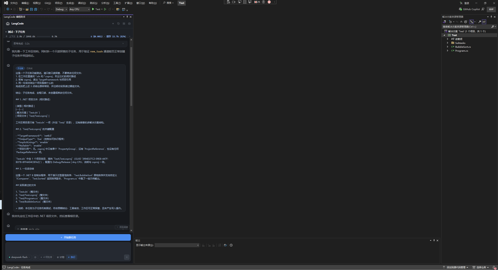

<div align="center">


<h1>LangCode</h1>

<p><strong>Visual Studio 里的 AI 编程助手。</strong> 它会聊天，但不止会聊天 —— 它能直接读懂你的项目、动手改代码、跑命令和测试，而且每一次「动你的文件」之前都会先给你看清楚改了什么，你点头它才落地。</p>

<p>一句话：把「能真正干活」的 AI Agent 装进 Visual Studio 的工具窗口。</p>

<p>
  
  
  
</p>

<p>
  <a href="https://gitee.com/li_qi_lang/lang-code/releases"></a>
</p>

<p>
  <a href="#安装">下载安装</a> ·
  <a href="#快速开始">快速开始</a> ·
  <a href="https://gitee.com/li_qi_lang/lang-code">Gitee 仓库</a> ·
  <a href="docs/ai-agent.md">AI 与自动化</a> ·
  <a href="docs/tools.md">工具参考</a> ·
  <a href="docs/README.md">文档索引</a>
</p>


</div>

---

## 目录

- [界面截图](#界面截图)
- [它能做什么](#它能做什么)
- [AI Agent 是怎么工作的](#ai-agent-是怎么工作的)
- [长任务编排：任务清单、子任务与提问](#长任务编排任务清单子任务与提问)
- [工具能力全景](#工具能力全景)
- [下载与安装](#安装)
- [快速开始](#快速开始)
- [怎么用](#怎么用)
- [支持的 AI 模型](#支持的-ai-模型)
- [安全与隐私](#安全与隐私)
- [数据存在哪里](#数据存在哪里)
- [从源码构建](#从源码构建)
- [项目结构](#项目结构)
- [深入文档](#深入文档)
- [许可证](#许可证)

## 界面截图

### 核心界面

<table align="center">
  <tr>
    <td align="center"><br /><sub>主界面</sub></td>
    <td align="center"><br /><sub>对话</sub></td>
  </tr>
  <tr>
    <td align="center"><br /><sub>设置页</sub></td>
    <td align="center"><br /><sub>历史页</sub></td>
  </tr>
</table>

### AI 编排与审批

<table align="center">
  <tr>
    <td align="center"><br /><sub>主动提问</sub></td>
    <td align="center"><br /><sub>任务清单</sub></td>
  </tr>
  <tr>
    <td align="center"><br /><sub>子任务</sub></td>
    <td align="center"><br /><sub>审批与差异卡</sub></td>
  </tr>
</table>

## 它能做什么

下面按「你实际会用它干的事」来讲，而不是按技术名词。

| 能力                   | 你会得到什么                                                              |
| ---------------------- | ------------------------------------------------------------------------- |
| 💬 **对话**            | 直接用中文或英文描述需求；自动带上当前文件、选中代码和编译诊断            |
| 🔍 **读代码 / 找代码** | 关键词搜索、语义检索、符号查找、引用查找、类型层次、查找实现              |
| ✏️ **改代码**          | 局部替换、整文件写入、按符号改写、多文件补丁、跨文件重命名                |
| 🖥️ **跑命令 / 跑测试** | 自动识别 .NET / Node.js / Python / Rust / Go / Java；跑完把结果读回来分析 |
| 🌐 **前端自测**        | 导航、点击、填表、执行脚本、截图、读取浏览器 console 报错                 |
| 🐞 **调试器联动**      | 断点、调用栈、局部变量、表达式求值；继续、单步、暂停、停止                |
| 🔌 **MCP 扩展**        | 连接 MCP 服务器、浏览市场条目、从其他工具导入现有配置                     |
| 🧠 **长任务编排**      | 任务清单、子任务、主动提问、计划模式，过程可见、可打断                    |
| ⏪ **检查点**          | 改动前自动留快照，可还原到某条消息之前，也可撤销上一步 / 本轮             |
| 🧩 **自由换模型**      | 国内、国外、本地模型都支持，多套配置可命名保存、随时切换                  |
| ⌨️ **编辑器内联**      | 解释、重构、测试、文档、修复选择；`Ctrl+K` 在光标处直接改                 |

**重要**：每一次写文件，它都会在窗口里显示一张**差异卡**，把「加了几行、删了几行」标得清清楚楚；你点「允许」它才真正保存，不满意就点拒绝。

## AI Agent 是怎么工作的

LangCode 的核心不是一个「问答接口」，而是一个 **Agent 循环**：

```text
你的需求
  → 带上系统提示词、工具清单、项目规则与自动上下文
  → 模型决定「直接回答」还是「调用工具」
  → 执行工具，把结果回灌给模型
  → 模型继续调用或给出最终答复
```

几个关键点：

- **动作块**：模型用 ` ```action ` 代码块发出工具调用（JSON）。一次可以发多个互不依赖的动作，减少往返。
- **有工作区权限**：能读文件、搜代码、按符号改写、多文件补丁、跨文件重命名、跑命令、跑测试、操作浏览器、查看调试器。
- **原生 function calling**：可选开启；OpenAI 兼容与 Anthropic 原生两种 `tools` 格式都支持。
- **改完还能跑通**：本轮真的改过文件时，会自动跑验证命令；失败时把输出回灌；还能读取 Visual Studio「错误列表」自动修复，最多 N 轮。
- **计划模式**：只向模型暴露只读工具，并在运行时拦截破坏性动作，适合先出方案再执行。

完整的循环、上下文压缩、费用控制与安全机制见 [AI 与自动化能力总览](docs/ai-agent.md)。

## 长任务编排：任务清单、子任务与提问

任务一多，它不会闷头乱做，而是把过程变得可见、可控：

| 能力     | 工具                      | 界面                                    | 说明                                                 |
| -------- | ------------------------- | --------------------------------------- | ---------------------------------------------------- |
| 任务清单 | `update_todo_list`        | 对话里的「任务进度」卡 + 窗口顶部进度条 | 每次整体替换；`[ ]` 待办、`[-]` 进行中、`[x]` 已完成 |
| 子任务   | `new_task`                | 「子任务」卡，子任务内部卡片缩进一格    | 独立跑一轮，完成后把自然语言结论带回父任务           |
| 主动提问 | `ask_followup_question`   | 提问卡 + 请求条                         | 选项可点击；也可自由输入；不想答可「跳过回答」       |
| 计划模式 | 输入框「计划 / 执行」芯片 | 只读调研 + 分步计划                     | 计划阶段不改文件、不跑命令；确认后切执行             |

### 子任务是怎么跑的

1. 父任务判断某块工作相对独立、且本身需要多步，调用 `new_task`，传入 `task` 与可选 `context`；
2. 插件创建一个子 Agent，带着同一套后端、工作区、设置与会话 id 独立跑一轮；
3. 子任务内部产生的工具卡片（读文件、改文件、差异卡等）照常显示，但在界面上缩进，表示它们属于这个子任务；
4. 子任务「不带动作」的那一轮文本会作为结论，回灌给父任务；
5. 父任务继续执行，或根据结论调整计划。

**限制与特点：**

- 子任务**最多一层**，不能在子任务里继续拆子任务；
- 同一轮里出现多个 `new_task` 时，顶层任务会**真并行**执行，再按原顺序收集结果；
- 并行子任务同时请求审批 / 提问时，界面会串行化，一次只显示一张；
- 自动验证 / 自动修复只在顶层任务执行，子任务内不重复跑；
- 一句话就能做完的事不要拆子任务，直接调用对应工具更省。

## 工具能力全景

| 类别       | 代表工具                                                                             | 能做什么                                                          |
| ---------- | ------------------------------------------------------------------------------------ | ----------------------------------------------------------------- |
| 代码理解   | `read_file` / `search_text` / `semantic_search` / `list_symbols` / `find_references` | 按行读文件、正则搜索、语义检索、符号与引用、类型层次、查找实现    |
| 代码修改   | `replace_in_file` / `write_file` / `edit_symbol` / `apply_patch` / `rename_symbol`   | 局部替换、整文件写入、按符号改写、多文件补丁、Roslyn 跨文件重命名 |
| 执行验证   | `run_command` / `run_tests`                                                          | 跑命令、自动识别并运行测试；`dotnet test` 返回结构化结果          |
| 浏览器     | `open_url` / `browser_action`                                                        | 打开网页、抓正文、导航 / 点击 / 填表 / 脚本 / 截图 / 读 console   |
| 扩展       | `mcp_call`                                                                           | 调用已启用 MCP 服务器上的工具                                     |
| 调试器     | `debug_inspect` / `debug_control`                                                    | 断点、调用栈、局部变量、表达式求值；继续 / 单步 / 暂停 / 停止     |
| 长任务编排 | `update_todo_list` / `ask_followup_question` / `new_task`                            | 任务清单、主动提问、子任务；另有 `goto_definition` 在编辑器中跳转 |

完整 24 个工具的参数、审批类别与示例见 [工具参考](docs/tools.md)。

---

## 快速开始

### 环境要求

| 项目 | 要求                              |
| ---- | --------------------------------- |
| 系统 | Windows 10 / 11                   |
| IDE  | Visual Studio 2022（17.0 及以上） |
| 框架 | .NET Framework 4.7.2              |

### 安装

**方式一：直接下载安装包（推荐，无需登录）**

- 下载地址：[`dist/LangCode.vsix`](https://gitee.com/li_qi_lang/lang-code/raw/master/dist/LangCode.vsix)
- 校验文件：[`dist/SHA256SUMS.txt`](https://gitee.com/li_qi_lang/lang-code/blob/master/dist/SHA256SUMS.txt)

下载后关闭 Visual Studio，双击 `.vsix`，按向导完成安装；重新打开 VS，在 **扩展 → 管理扩展 → 已安装** 中确认 LangCode 已启用。

**方式二：从 Gitee 发行版下载**

打开 [Gitee 发行版页面](https://gitee.com/li_qi_lang/lang-code/releases)，在对应版本中下载 `LangCode.vsix` 或带版本号的 `LangCode-1.0.0.vsix`。发行版适合固定版本、归档与回滚。

**方式三：从源码构建安装包**

```cmd
scripts\package.cmd
```

产物为 `dist\LangCode.vsix`，双击即可安装。完整命令与手动构建步骤见 [安装与分发](docs/install.md)。

> 安装、升级、卸载、企业离线部署与常见问题，统一见 [安装与分发](docs/install.md)。

### 配置并使用

1. 打开工具窗口：菜单 **工具 → 打开 LangCode**（也可以在代码窗口右键 → **LangCode**）；
2. 在**设置**里选一个「API 提供商」，填入你的 API Key（用本地模型可留空）；
3. 选一个模型（下拉里可选，也可以直接输入模型名）；
4. 在输入框里描述你的需求，回车开始。

> 第一次使用建议：先打开一个解决方案 / 文件夹，再试一句「帮我看看这个项目是做什么的」；想先看方案就点「计划」或输入 `/plan`。

## 怎么用

### 直接对话

在输入框里正常打字即可。它会自动感知你当前打开的文件和选中的代码。

### 常用操作速查

| 想做什么                      | 怎么做                                                  |
| ----------------------------- | ------------------------------------------------------- |
| 让 AI 重点看某个文件 / 文件夹 | 输入 `@`，从工作区里选择                                |
| 先出方案、不动代码            | 点输入框下方「计划」，或输入 `/plan`                    |
| 审查未提交的改动              | 输入 `/review`                                          |
| 为最近改动补测试              | 输入 `/test`                                            |
| 就地修改选中代码              | 选中代码 → 右键 **LangCode → 内联编辑**（`Ctrl+K`）     |
| 改完不满意                    | 「撤销上一步」/「撤销本轮」，或点消息上的「还原到此处」 |
| Agent 生成中还想发任务        | 直接回车，新消息会排队，当前这轮结束后自动接着跑        |
| 看历史 / 换会话               | 打开「历史记录」抽屉，按标题 / 摘要 / 模型搜索          |

### 用 `/` 呼唤常用指令

在输入框里输入 `/` 会弹出命令列表：

| 命令       | 作用                                     |
| ---------- | ---------------------------------------- |
| `/plan`    | 先别动代码，只做调研并给出分步计划       |
| `/review`  | 审查你还没提交的改动，按严重程度列出问题 |
| `/commit`  | 按 Conventional Commits 生成提交信息     |
| `/test`    | 为最近改动的代码补单元测试               |
| `/fix`     | 先说清根因，再给最小改动                 |
| `/explain` | 解释一段代码的作用和坑                   |
| `/clear`   | 清空当前会话（历史仍在）                 |

### 代码窗口右键菜单

选中一段代码，右键 → **LangCode**：

| 菜单项               | 作用                         |
| -------------------- | ---------------------------- |
| 解释选择             | 讲清楚这段代码在干嘛         |
| 重构选择             | 帮你重构                     |
| 生成测试             | 补单元测试                   |
| 生成文档             | 补注释 / 文档                |
| 修复选择             | 定位并修问题                 |
| 内联编辑（`Ctrl+K`） | 在光标处直接改，改完就地替换 |

### 常用快捷键

| 快捷键        | 作用                                 |
| ------------- | ------------------------------------ |
| `Ctrl+K`      | 选区内联编辑                         |
| `Esc`         | 生成中停止；有审批时拒绝             |
| `Enter`       | 发送；审批时允许；等待回答时提交答案 |
| `Shift+Enter` | 输入框内换行                         |

## 支持的 AI 模型

配置时选择「提供商」即可，内置了 30 多家，常见的都在：

| 类别        | 常见提供商                                                                     |
| ----------- | ------------------------------------------------------------------------------ |
| 国内        | DeepSeek、Kimi / Moonshot、通义千问、智谱 GLM、MiniMax、SiliconFlow、小米 MiMo |
| 国外        | OpenAI、Anthropic、Google Gemini、xAI (Grok)、Mistral、Groq、OpenRouter、Poe   |
| 本地 / 自建 | Ollama、LM Studio、LiteLLM、任意 OpenAI 兼容网关                               |

想用列表里没有的模型？选「OpenAI Compatible」，自己填一个兼容地址即可。还可以把多套配置**命名保存**（比如「公司网关」「本地模型」），随时切换。

## 安全与隐私

这一块设计得比较克制，核心就一句：**动你东西之前，先问你。**

| 保护       | 作用                                                                             |
| ---------- | -------------------------------------------------------------------------------- |
| 计划模式   | 只向模型暴露只读工具，并在运行时拦截破坏性动作                                   |
| 写文件审批 | 每一次修改都生成差异卡，你确认才落盘                                             |
| 命令审批   | 执行终端命令前默认询问；危险命令直接拒绝                                         |
| 分类放行   | 可在 **Auto** 芯片或设置页按「读取 / 编辑 / 新增 / 命令 / 浏览器 / MCP」分别放开 |
| 检查点     | 改动前自动留快照，可还原到某条消息之前                                           |
| 工作区边界 | 所有文件操作都限制在项目目录内                                                   |

## 数据存在哪里

所有数据都放在你本机，路径为 `%APPDATA%\LangCode\vsext\`：

| 内容             | 说明                                                           |
| ---------------- | -------------------------------------------------------------- |
| `settings.json`  | 你的所有设置；API Key 使用 Windows DPAPI 加密后落盘            |
| `conversations\` | 历史会话：每个会话一个 JSON 文件，另有 `index.json` 元数据索引 |
| `usage.jsonl`    | 每次模型调用的 token 用量与费用（按会话归集）                  |
| `checkpoints\`   | 检查点影子仓库（git），用于把文件还原到某一轮之前              |
| `audit.log`      | 工具调用日志（默认关闭，开启后才有；超过 2MB 自动轮转）        |

想重置设置就删掉 `settings.json`；想清空历史就删掉 `conversations` 目录；想同时清掉检查点就删掉 `checkpoints` 目录。

## 从源码构建

一键打包（还原 + Release 构建 + 复制到 `dist/` + 生成 SHA256 校验文件）：

```cmd
scripts\package.cmd
```

手动构建：

```cmd
:: 还原依赖
dotnet restore LangCode.sln

:: 构建（Release）
dotnet build LangCode/LangCode.csproj -c Release
```

- 生成程序集：`LangCode/bin/Release/net472/LangCode.dll`
- 生成安装包：`LangCode/bin/Release/net472/LangCode.vsix`
- 分发副本：`dist/LangCode.vsix`、`dist/LangCode-<版本>.vsix`、`dist/SHA256SUMS.txt`

发布到 Gitee 发行版（需要私人令牌）：

```cmd
set GITEE_TOKEN=你的令牌
powershell -ExecutionPolicy Bypass -File scripts\publish-gitee.ps1
```

调试时项目会以 Visual Studio **实验实例**（`/rootsuffix Exp`）启动，不影响你日常使用的 VS。

## 项目结构

```
docs/               功能文档：AI 与自动化、子任务、工具参考
LangCode/
├── Agent/          AI 的「大脑」：工具定义、对话循环、提示词、长任务编排
├── Chat/           各种 AI 服务商的接口适配（含 Anthropic 原生协议）
├── Domain/         数据模型：提供商、模型、设置、审批、任务清单
├── Mcp/            MCP 工具支持（客户端、管理器、市场、配置导入）
├── Persistence/    设置、历史会话、用量与审计日志的本地存储
├── Roslyn/         C# 代码分析（符号、引用、重命名）
├── Ui/             界面（工具窗口、抽屉、主题、图标）
├── VsIntegration/  与 Visual Studio 的对接（编辑器、调试器、诊断、测试）
├── Vsx/            扩展入口与菜单
└── Workspace/      工作区能力（文件、命令、语义检索、浏览器、检查点等）
```

## 深入文档

| 文档                                    | 内容                                                                                        |
| --------------------------------------- | ------------------------------------------------------------------------------------------- |
| [安装与分发](docs/install.md)           | 下载渠道、安装 / 升级 / 卸载、企业离线部署、SHA256 校验、常见问题、打包与发布流程           |
| [AI 与自动化能力总览](docs/ai-agent.md) | Agent 循环、子任务、任务清单、主动提问、计划模式、自动验证 / 修复、上下文与成本、安全与回退 |
| [工具参考](docs/tools.md)               | 全部 24 个工具的参数、审批类别、破坏性标记、调用协议与示例                                  |
| [文档索引](docs/README.md)              | 文档导航与名词解释                                                                          |

## 许可证

本项目基于 [Apache License 2.0](LICENSE) 开源。
