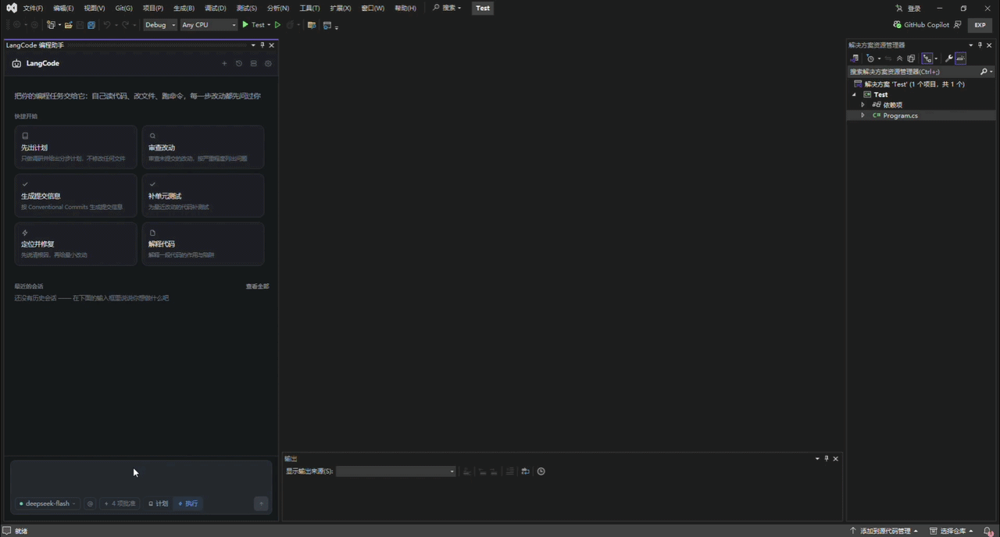
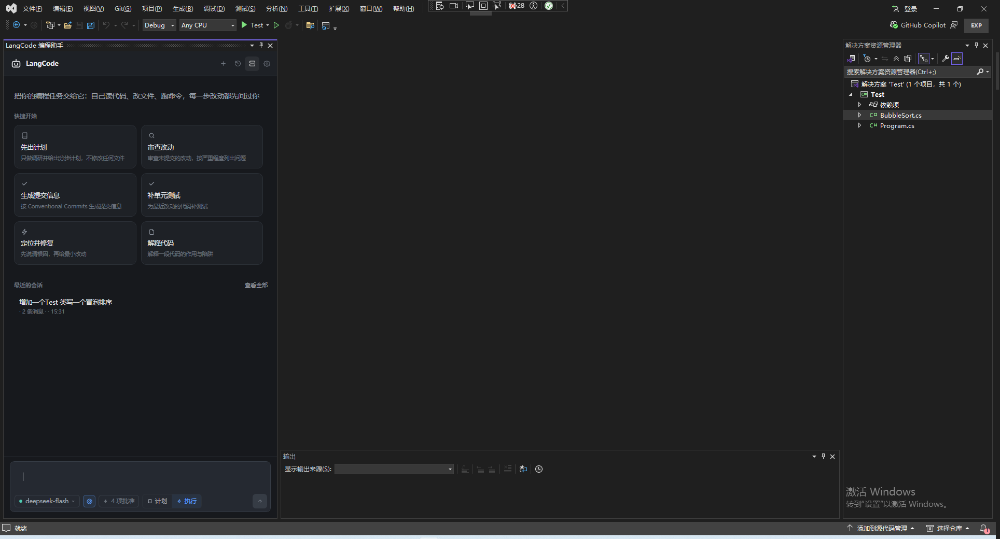
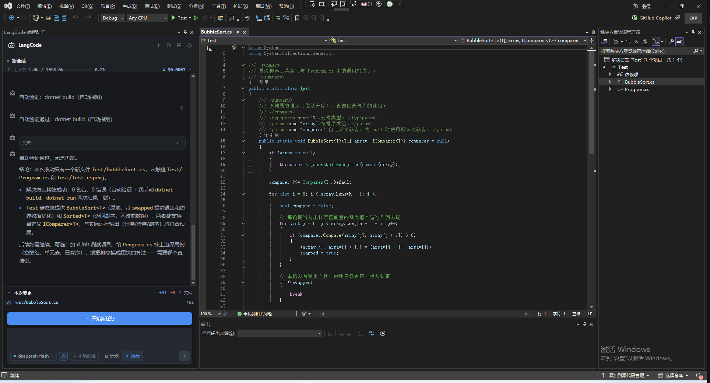
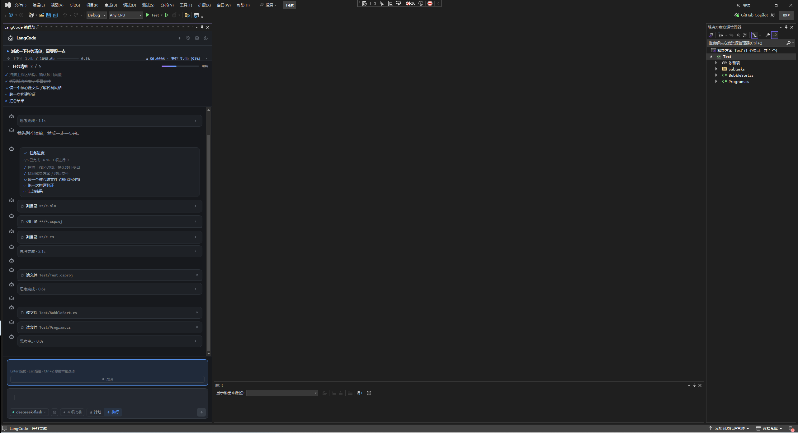
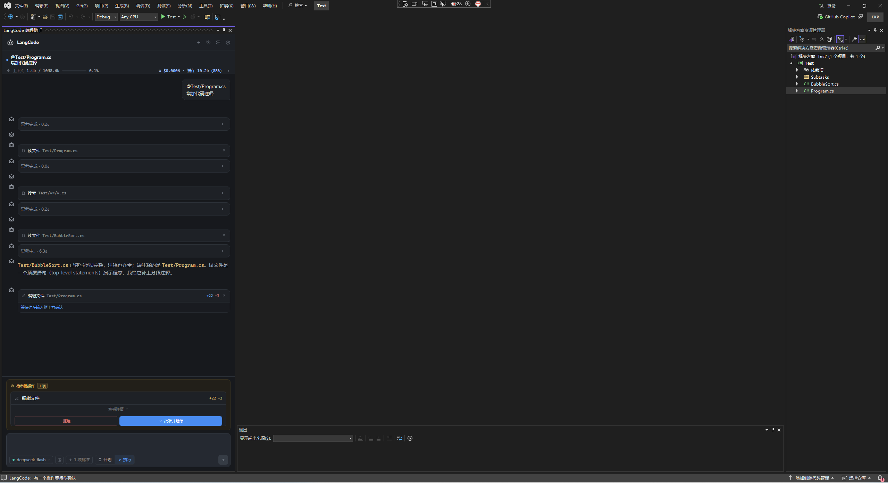
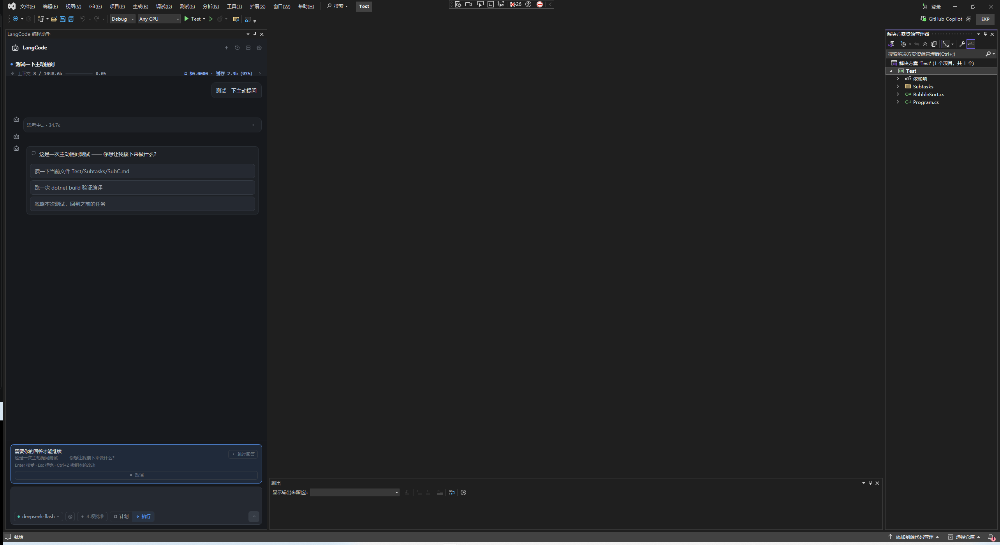
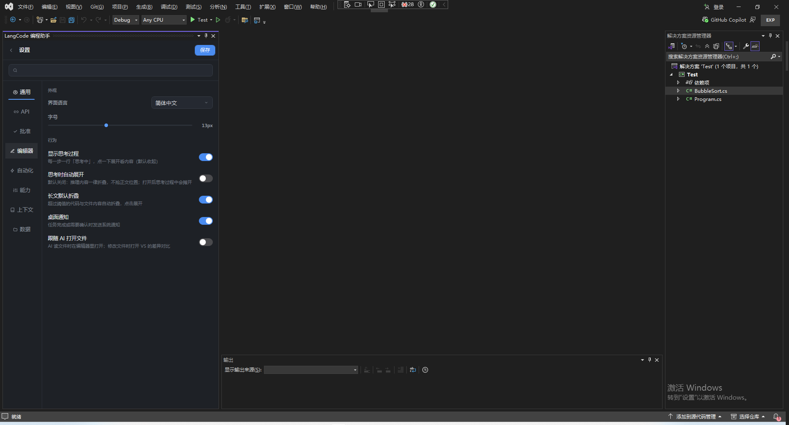

<div align="center">


<h1>LangCode</h1>

<p><strong>Visual Studio 里的 AI 编程助手</strong></p>

<a href="https://gitee.com/li_qi_lang/lang-code"></a>
<a href="https://gitee.com/li_qi_lang/lang-code"></a>


</p>

<p>
  <a href="https://gitee.com/li_qi_lang/lang-code/raw/master/dist/LangCode.vsix"></a>
</p>

<p>
  <a href="#快速开始">快速开始</a> ·
  <a href="docs/install.md">安装说明</a> ·
  <a href="docs/ai-agent.md">AI 与自动化</a> ·
  <a href="docs/tools.md">工具参考</a> ·
  <a href="docs/README.md">文档索引</a>
</p>



</div>

---

## 项目简介

LangCode 是一个 **Visual Studio 2022 扩展**，把具备工作区权限的 AI Agent 装进 IDE 工具窗口。它不是只会回文字的聊天框：能读代码、找代码、改代码、跑命令、跑测试、操作浏览器、读取调试器，并把过程用「任务清单 + 差异卡 + 审批」呈现出来。

> 一句话：让 AI 在你的项目里动手干活，同时把控制权留在你手上。

## 项目亮点

- **真的会改代码**：局部替换、整文件写入、按符号改写、多文件补丁、Roslyn 跨文件重命名。
- **改前先问你**：写文件生成差异卡，执行命令先确认，危险命令直接拒绝。
- **改得对、改得通**：改完自动跑验证，失败自动回灌输出，还能读取「错误列表」自动修复。
- **长任务看得见**：任务清单、子任务（可并行）、主动提问、计划模式，随时可打断。
- **改错了能回去**：每轮自动打检查点，支持撤销上一步 / 撤销本轮 / 还原到某条消息之前。
- **模型自由**：内置 30+ 提供商，国内、国外、本地与自建网关都支持，多套配置可命名切换。

## 界面截图

<table align="center">
  <tr>
    <td align="center"><br /><sub>主界面</sub></td>
    <td align="center"><br /><sub>对话</sub></td>
    <td align="center"><br /><sub>任务清单</sub></td>
  </tr>
  <tr>
    <td align="center"><br /><sub>审批与差异卡</sub></td>
    <td align="center"><br /><sub>主动提问</sub></td>
    <td align="center"><br /><sub>设置页</sub></td>
  </tr>
</table>

## 功能一览

| 能力              | 说明                                                                        |
| ----------------- | --------------------------------------------------------------------------- |
| 💬 对话           | 中文或英文描述需求，自动带上当前文件、选中代码与编译诊断                    |
| 🔍 代码理解       | 关键词搜索、语义检索、文档检索、符号与引用、类型层次、查找实现              |
| ✏️ 代码修改       | 局部替换、整文件写入、按符号改写、多文件补丁、跨文件重命名                  |
| 🖥️ 执行验证       | 自动识别 .NET / Node.js / Python / Rust / Go / Java，跑命令与测试并回读结果 |
| 🌐 联网与前端自测 | Bing / DuckDuckGo 免 Key 搜索；导航、点击、填表、执行脚本、截图、读 console |
| 🐞 调试器联动     | 断点、调用栈、局部变量、表达式求值；继续、单步、暂停、停止                  |
| 🔌 MCP 扩展       | 连接 MCP 服务器、浏览市场条目、从其他工具导入配置                           |
| 🧠 长任务编排     | 任务清单、子任务、主动提问、计划模式                                        |
| ⏪ 检查点         | 改动前自动快照，可还原到某条消息之前                                        |
| ⌨️ 编辑器内联     | 解释、重构、测试、文档、修复选择；`Ctrl+K` 在光标处直接改                   |

完整 26 个工具的参数与审批类别见 [工具参考](docs/tools.md)。

## 快速开始

**环境要求**：Windows 10 / 11（64 位） · Visual Studio 2022（17.0+） · .NET Framework 4.7.2+

**安装**

1. 下载 [LangCode.vsix](https://gitee.com/li_qi_lang/lang-code/raw/master/dist/LangCode.vsix)；
2. 关闭 Visual Studio，双击 `.vsix` 按向导安装；
3. 打开 Visual Studio，在 **扩展 → 管理扩展 → 已安装** 中确认已启用；
4. 菜单 **工具 → 打开 LangCode** 打开工具窗口。

**配置**

1. 在 **设置** 中选择 API 提供商并填入 API Key（本地模型可留空）；
2. 选择或直接输入模型名；
3. 输入需求，回车开始。建议先打开解决方案，再试一句「帮我看看这个项目是做什么的」。

## 常用操作

| 想做什么                      | 怎么做                                                |
| ----------------------------- | ----------------------------------------------------- |
| 让 AI 重点看某个文件 / 文件夹 | 输入 `@`，从工作区选择                                |
| 先出方案、不动代码            | 点「计划」，或输入 `/plan`                            |
| 审查未提交的改动 / 补测试     | `/review` / `/test`                                   |
| 就地修改选中代码              | 选中代码 → 右键 **LangCode → 内联编辑**（`Ctrl+K`）   |
| 改完不满意                    | 「撤销上一步」/「撤销本轮」，或消息上的「还原到此处」 |
| 生成中还想发任务              | 直接回车排队，当前轮结束后自动执行                    |

**常用指令**：`/plan` 计划 · `/review` 审查 · `/commit` 生成提交信息 · `/test` 补测试 · `/fix` 修复 · `/explain` 解释 · `/clear` 清空会话

**快捷键**：`Ctrl+K` 内联编辑 · `Esc` 停止 / 拒绝 · `Enter` 发送 / 允许 · `Shift+Enter` 换行

## 支持的 AI 模型

| 类别        | 常见提供商                                                                     |
| ----------- | ------------------------------------------------------------------------------ |
| 国内        | DeepSeek、Kimi / Moonshot、通义千问、智谱 GLM、MiniMax、SiliconFlow、小米 MiMo |
| 国外        | OpenAI、Anthropic、Google Gemini、xAI (Grok)、Mistral、Groq、OpenRouter、Poe   |
| 本地 / 自建 | Ollama、LM Studio、LiteLLM、任意 OpenAI 兼容网关                               |

列表之外可选择「OpenAI Compatible」自行填写地址；多套配置可命名保存、随时切换。

## 安全与隐私

- **计划模式**：只暴露只读工具，运行时拦截破坏性动作。
- **写文件审批**：每次修改生成差异卡，确认才落盘。
- **命令审批**：执行前默认询问，危险命令直接拒绝；可按「读取 / 编辑 / 新增 / 命令 / 浏览器 / MCP」分类放行。
- **工作区边界**：所有文件操作限制在项目目录内；改动前自动留检查点。

所有数据保存在本机 `%APPDATA%\LangCode\vsext\`：`settings.json`（API Key 经 Windows DPAPI 加密）、`conversations\`、`usage.jsonl`、`checkpoints\`、`audit.log`。

## 技术栈

C# · .NET Framework 4.7.2 · WPF · Roslyn · Visual Studio SDK · MCP · Chrome DevTools Protocol

## 项目结构

```text
docs/               功能文档：AI 与自动化、安装、工具参考
LangCode/
├── Agent/          Agent 循环、工具定义、提示词、长任务编排
├── Chat/           各 AI 服务商接口适配（含 Anthropic 原生协议）
├── Domain/         提供商、模型、设置、审批、任务清单等数据模型
├── Mcp/            MCP 客户端、管理器、市场与配置导入
├── Persistence/    设置、会话、用量、审计日志的本地存储
├── Roslyn/         C# 符号、引用与重命名
├── Ui/             工具窗口、抽屉、主题与图标
├── VsIntegration/  编辑器、调试器、诊断、测试等 VS 对接
├── Vsx/            扩展入口与菜单
└── Workspace/      文件、命令、语义检索、浏览器、检查点
```

## 文档

| 文档                                    | 内容                                                          |
| --------------------------------------- | ------------------------------------------------------------- |
| [安装与分发](docs/install.md)           | 下载、安装、升级、卸载与常见问题                              |
| [AI 与自动化能力总览](docs/ai-agent.md) | Agent 循环、子任务、自动验证 / 修复、上下文与成本、安全与回退 |
| [工具参考](docs/tools.md)               | 全部 26 个工具的参数、审批类别与调用示例                      |
| [文档索引](docs/README.md)              | 文档导航与名词解释                                            |

## 许可证

本项目基于 [Apache License 2.0](LICENSE) 开源。欢迎提交 Issue 与 PR。
